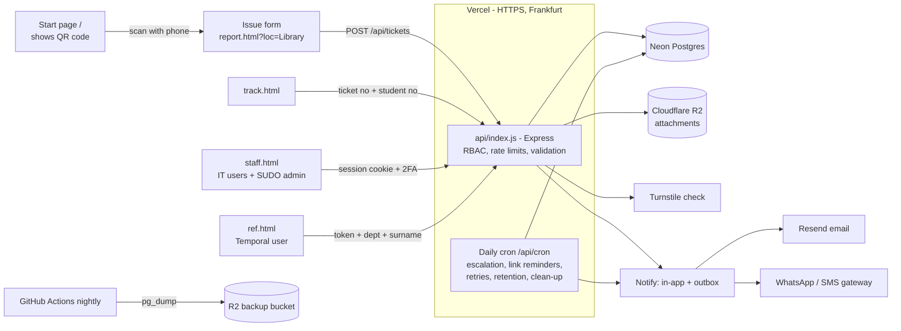
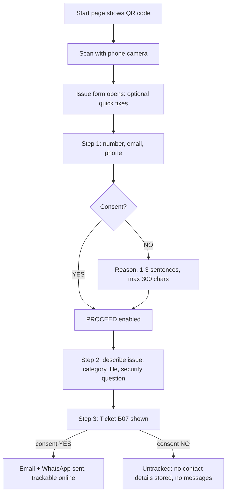
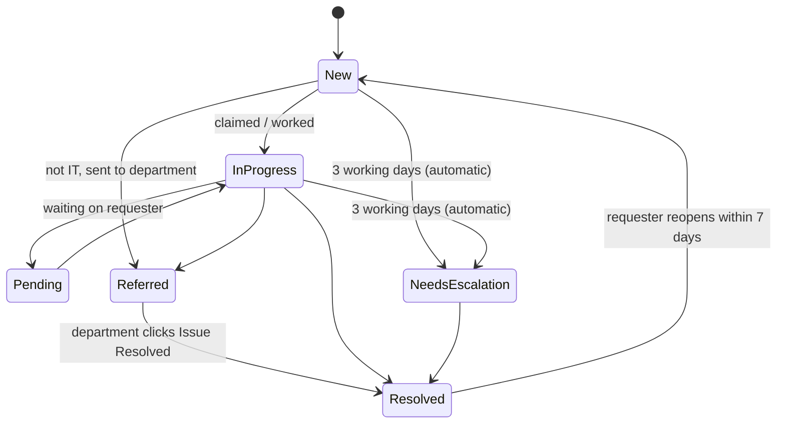

# University IT Helpdesk

A simple, secure ticketing system. Students and staff scan a QR code, fill in three short steps, and get a ticket number. IT staff work the tickets on a dashboard. Issues that are not IT-related go to other departments through secure temporary links.

**To put it online, follow [DEPLOY.md](DEPLOY.md)** (Vercel + Neon + Cloudflare R2 + Resend + Turnstile, all on free tiers).

Run it on your own PC (no database server needed: a built-in Postgres is used when `DATABASE_URL` is empty):

```bash
npm install
```
```bash
npm run create-user -- CU001 "Your Name" you@university.ac.zm admin
```
```bash
npm run dev
```

Then open http://localhost:3000 (staff: `/staff.html`). Run the tests with `npm test`. Stop `npm run dev` before running `create-user` or `reset-user` locally, because the local database can only be opened by one program at a time.

---

## 1. Tech stack and why

| Part | Choice | Why |
|---|---|---|
| Hosting | **Vercel** (pages on its CDN, API as one serverless function) | Free tier, HTTPS and deploys from GitHub with no server to maintain. |
| Server code | **Node.js 24 with Express 5** | One language for the whole project. Express 5 passes errors from async code to the error handler. |
| Database | **Postgres on Neon** (any Postgres works, e.g. Supabase) | Managed and serverless, and it doesn't pause the whole project when quiet. Locally and in tests, PGlite (Postgres compiled to run inside Node) stands in, so no install is needed. |
| File storage | **Cloudflare R2**, private bucket | Free 10 GB, no download fees. Files are only handed out through the staff API after a login check. |
| Email | **Resend** HTTP API | Simple API key, free tier. Without a key, messages are logged instead of sent. |
| CAPTCHA | **Cloudflare Turnstile**, with an arithmetic fallback | Free, privacy-friendly, usually invisible to people. |
| WhatsApp/SMS | Any HTTP gateway (`WHATSAPP_WEBHOOK_URL`) | Works with any provider (Meta WhatsApp Cloud API, Twilio, Africa's Talking) through a small adapter. |
| Front end | **Plain HTML, CSS and JavaScript** (no framework, no build step) | Pages are about 10–30 KB, so they load fast on slow mobile data. |

Passwords (scrypt), 2FA (TOTP), tokens and the fallback CAPTCHA use Node's built-in `crypto`, so the security-critical code is small and stays in this repository.

## 2. Architecture and user flows



**Requester flow**



**Ticket life cycle**



Every change is written to `ticket_events` (who, when, from, to, note) and to `audit_log`.

**Department referral flow**

1. The IT user opens a ticket and picks **Refer**: department (e.g. SOH), surname (MUCHINDU) and a short description.
2. If that person already has an active link, the ticket is added to it. If not, a new link is created with a 256-bit random token. Only the token's SHA-256 hash is stored.
3. The link is emailed to the department's address and expires at the end of the 5th working day (counting today; weekends and holidays are skipped).
4. The recipient opens the link and confirms **department and surname**. Five wrong tries lock the link.
5. They see only the ticket number and IT's description. They click **Issue Resolved** with an optional note. The action is logged as `Temporal user (SOH – MUCHINDU)`, and the assigned IT user and the admins are notified.
6. A reminder is emailed 1 working day before expiry. IT can **resend** (this issues a new token and the old one stops working), **extend** (with a required reason) or **revoke**.

## 3. Database schema

All tables are created by [server/db.js](server/db.js). The main ones:

| Table | Key columns | Notes |
|---|---|---|
| `tickets` | `id` (UUID PK), `seq` (UNIQUE), `number` (A01…), `requester_no`, `email`, `phone`, `consent`, `consent_reason`, `consent_at`, `tracked`, `category`, `issue`, `location`, `priority`, `status`, `assigned_to`, `duplicate_of`, `widespread`, `created_at`, `opened_at`, `resolved_at`, `reminded_at`, `escalated_at`, `reopen_count`, `rating`, `rating_comment`, `anonymised` | `id` and `seq` are globally unique; `number` is the friendly display value. Contact columns are NULL when consent = NO. |
| `ticket_events` | `ticket_id`, `at`, `actor`, `type`, `from_status`, `to_status`, `note`, `is_public` | Status history, notes (`is_public = 0` means internal) and assignments. |
| `attachments` | `ticket_id`, `name`, `mime`, `size`, `storage_key` | The file itself is in R2. PNG, JPG or PDF, max 2 MB. The file's first bytes are checked, not just its type label. |
| `users` | `username` (IT-CU411), `full_name`, `email`, `role` (`it`/`admin`), `pw_hash`, `must_change_pw`, `totp_secret`, `active` | |
| `sessions` | `id_hash`, `user_id`, `expires_at`, `absolute_expires_at` | Only the cookie's hash is stored. Sessions end after 30 minutes idle and 8 hours at most. |
| `rate_limits` | `key` (hashed), `n`, `reset_at` | Shared counters, because serverless instances share no memory. |
| `departments` | `code`, `name`, `email`, `active` | ACCOUNTS, SOB, SOH, SOE, editable in Settings. |
| `referral_links` | `token_hash`, `department`, `surname`, `expires_ymd`, `expires_at`, `revoked_at`, `reminder_sent`, `failed_attempts` | |
| `referrals` | `link_id`, `ticket_id`, `description`, `resolved_at`, `resolution_note` | One row per ticket referred to a link. |
| `notifications` | `user_id`, `message`, `ticket_id`, `read_at` | In-system alerts (the bell). |
| `outbox` | `channel`, `recipient`, `subject`, `body`, `sent_at`, `error` | Every email/WhatsApp message, so failures can be seen and retried. |
| `audit_log` | `at`, `actor`, `action`, `details`, `ip` | Sign-ins, failed sign-ins, views, changes, exports, settings. |
| `settings` | `key`, `value` (JSON) | Holidays, thresholds, SLA hours, categories, canned replies, retention. |
| `kb_articles` | `title`, `body` | Quick fixes shown before a ticket is submitted. |
| `counters` | `name`, `value` | The global ticket counter. |

## 4. Page-by-page UI

All pages are mobile-first, work with keyboard and screen readers (labels, `aria-live` errors, focus moved to each new step, 44 px touch targets), switch to dark mode automatically or with the **Theme** button, and print cleanly.

**Start page (`/`)**
- Large QR code with "Need IT help? Scan this QR code…", the four steps, a "Tap here" button for people already on their phone, and **Print poster**. `/?loc=Library` puts the location into the QR code.

**Issue form (`/report.html`, opened by scanning the QR code)**
- "Try a quick fix first": searchable knowledge base.
- Stepper: 1. Details, 2. Issue, 3. Ticket.
- **Step 1:** student/staff number, email and phone (international format, e.g. +260971234567), each checked inline. Consent YES/NO. These are radio buttons because only one can be chosen, which is the accessible control for that. Choosing NO shows the reason box with a live 0/300 counter; PROCEED is enabled only when a reason is given. A privacy notice sits under the consent question.
- **Step 2:** optional category, a large text area (up to 10,000 characters, about 1,500 words) with a live word count, an optional file, and a simple security question. PROCEED is disabled while the text is empty or only spaces. Everything typed is kept if the user goes back or refreshes.
- **Step 3:** large "Ticket B07" with the right message for tracked or untracked tickets.

**Track (`/track.html`):** ticket number + student/staff number, then status and public history. When resolved: a 1–5 star rating and comment, and **Reopen** for 7 days.

**Referral (`/ref.html#t=…`):** confirm department and surname, then a list of referred issues, each with a note box and an **Issue Resolved** button. The token is in the `#` part of the link, so it never reaches server logs, and it is removed from the address bar once read.

**Staff (`/staff.html`)**
- Sign in with the IT ID and password. Admins must set up an authenticator app (QR code shown) on first sign-in, then enter a 6-digit code every time. A temporary password must be changed on first use.
- Header: live clock (server time, Africa/Lusaka), alerts bell, sign out.
- Counters: Received today, Completed today, Pending (open), Needs escalation, Referred.
- **Tickets:** filters for date range, status, category, priority, department, IT user and free text. Rows show priority, SLA (due in / overdue), and Untracked, Duplicate and Widespread flags. Opening a ticket shows the requester details, issue, attachment, an update form (status, priority, category, assignee, note with canned replies, "visible to requester" tick box), Claim, Refer, referrals and full history.
- **My dashboard:** assigned/open/resolved counts, average resolution time, my open tickets.
- **Referral links:** state, progress, Resend / Extend / Revoke.
- Admin only: **Reports** (per day, category, status, QR location, department referrals, per IT user, average resolution time and rating; Excel CSV export and print to PDF), **Users** (add IT-<StaffID>, disable, reset password or 2FA), **Settings** (holidays, thresholds, SLA, categories, canned replies, departments, retention, knowledge base), **QR codes** (with location tag, printable), **Audit log**.

## 5. Core code

| Feature | Where |
|---|---|
| Ticket numbering A01…A50, B01…Z50, AA01… | `ticketNumber()` in [server/lib.js](server/lib.js) |
| No duplicate numbers under concurrent submissions | `tx()` + `nextTicketNumber()` in [server/db.js](server/db.js): inside a transaction, `UPDATE counters … RETURNING` locks the counter row until commit, so simultaneous submissions queue up; `seq` is `UNIQUE` as a second safety net |
| Daily jobs (Vercel Cron) | `/api/cron` in [server/app.js](server/app.js), protected by `CRON_SECRET` |
| Production safety checks | [server/config.js](server/config.js): refuses to start without `DATABASE_URL`, `APP_SECRET`, `BASE_URL`, `CRON_SECRET` |
| File storage / email | [server/storage.js](server/storage.js) (R2), [server/notify.js](server/notify.js) (Resend) |
| Working days, holidays, Lusaka time | `workingDaysBetween()`, `nthWorkingDay()`, `localYmd()` in [server/lib.js](server/lib.js) |
| Referral link create/resend/extend/resolve | [server/tickets.js](server/tickets.js) |
| Escalation scheduler (2-day reminder, 3-day admin alert) | `runEscalation()` in [server/jobs.js](server/jobs.js) |
| Security middleware (headers, HTTPS, rate limit, CAPTCHA, sessions, RBAC, CSRF) | [server/security.js](server/security.js) |
| Public API / staff API | [server/public-routes.js](server/public-routes.js), [server/staff-routes.js](server/staff-routes.js) |

**How "working days" are counted:** a ticket opened on Monday has 1 working day on Tuesday, 2 on Wednesday (the IT user gets a reminder) and 3 on Thursday (the admin gets an email and an in-system alert: *"Ticket B07 assigned to IT-CU411 has been unresolved for 3+ working days."*, and the status becomes Needs Escalation). Weekends and holidays from Settings are skipped. Reopening a ticket restarts the count.

**Ticket numbers:** the counter never resets, so display numbers never repeat (after ZZ50 comes AAA01). Each record also has a UUID `id` and a unique `seq`, so the database never depends on the display number, and tracking needs the student number as well.

## 6. Security and data protection

- **Access:** roles are `it` and `admin`; the department user has no account and can only reach their own link's items. Passwords use scrypt. Admins need TOTP 2FA. Sessions time out after 30 minutes idle and 8 hours at most. Five failed sign-ins lock that ID for 15 minutes. `npm run reset-user` recovers a locked-out admin.
- **Production settings:** the app refuses to start without its secrets, so it can't run half-configured. The cron endpoint needs `CRON_SECRET`.
- **Web:** HTTPS only (HSTS is set). The cookie is `__Host-sid; HttpOnly; Secure; SameSite=Strict`, and every change also needs an `X-Requested-With` header (CSRF protection). A strict Content-Security-Policy is set on pages and API, and the one CDN script has an integrity hash.
- **Input:** all SQL uses bound parameters (no SQL injection). All user text is shown with `textContent` (no XSS). Lengths and formats are checked on the server, files are checked by content, and CSV export blocks spreadsheet formula injection.
- **Files:** R2 bucket is private. Downloads go through the staff API and are recorded in the audit log.
- **Spam and guessing:** Cloudflare Turnstile plus a hidden honeypot field. Rate limits are stored in the database and sized for campus Wi-Fi, where hundreds of students share one IP address:

  | What | Limit per 10 minutes |
  |---|---|
  | Tickets per student number | 3 |
  | Tickets per IP | 60 |
  | Tracking lookups per ticket number (stops guessing the student number) | 10 |
  | Tracking lookups per IP | 100 |

  Sign-in allows 5 attempts per IT ID and 50 per IP, both per 15 minutes.
- **Data Protection Act No. 3 of 2021:** a privacy notice at the point of collection. If consent is NO, **no** contact details are stored (only the reason and time). Departments see no personal data. Contact details and files are removed automatically `retentionDays` (default 730) after resolution. Every view, change and export is in the audit log. Before go-live, confirm the wording and retention period with the university's data protection officer.

## 7. Testing checklist

Automated (`npm test`, 23 tests, on an in-memory Postgres): numbering, uniqueness over 50,000 numbers, working days, holidays and year boundaries, link expiry, Lusaka time, password hashing, TOTP (RFC 6238 test vector), validation, consent YES/NO storage, CAPTCHA, attachment storage and fake-file rejection, the per-student limit (and another student on the same IP still getting through), tracking and the guessing limit, 60 concurrent submissions with no duplicate numbers, sign-in, forced password change, roles, CSRF, attachment download, the referral link (wrong surname, wrong token, data shown, resolve), rating and reopen, the 2-day reminder and 3-day escalation, the cron secret, admin 2FA enrolment, reports and CSV, and the production settings check.

Not covered by the automated tests: real Neon, R2, Resend and Turnstile. Check those with the list in [DEPLOY.md](DEPLOY.md) step 10.

Manual, before go-live:
- [ ] Intake on a real phone over a slow connection (Chrome DevTools "Slow 3G").
- [ ] Keyboard only: tab through all three steps; errors are announced by a screen reader (NVDA or VoiceOver).
- [ ] Contrast check (WAVE or axe) in light and dark mode.
- [ ] Consent NO: ticket shows "Untracked", no email or WhatsApp is sent, and it cannot be tracked.
- [ ] Refresh in the middle of step 2: the text is still there.
- [ ] Upload a 3 MB file and a `.exe` renamed to `.png`: both rejected.
- [ ] A real email arrives through Resend, and a WhatsApp message through your gateway (if used).
- [ ] Referral: the link opens on a phone, a wrong surname is refused, Issue Resolved notifies IT and the admin.
- [ ] Set the escalation threshold to 1 day and check the admin gets an email and an alert.
- [ ] Admin 2FA with Google and Microsoft Authenticator.
- [ ] Session times out after 30 minutes idle.
- [ ] Restore a backup dump into a spare Neon branch.
- [ ] Check the holiday list against this year's government gazette.

## 8. Deployment

Step by step in **[DEPLOY.md](DEPLOY.md)**: GitHub, then Neon, R2, Turnstile and Resend, then Vercel. After that, create the first admin, set up nightly backups, and run the live checks. It also explains why Neon was chosen over Supabase and why everything is hosted on Vercel rather than split with Cloudflare Pages.

## Not included (kept simple on purpose)

- **Multi-language:** all text is plain HTML in a few files, so a translated copy of `report.html` / `intake.js` is the simplest route when a language is chosen. No translations were guessed.
- **Message templates** are fixed in code ([server/tickets.js](server/tickets.js), [server/jobs.js](server/jobs.js)) instead of being editable in Settings.
- **SLA timers** count calendar hours; escalation counts working days.
- **Scheduled jobs run once a day** on Vercel's free plan (about 07:00 Lusaka time), so reminders and escalations can arrive up to a day after the threshold is crossed.
